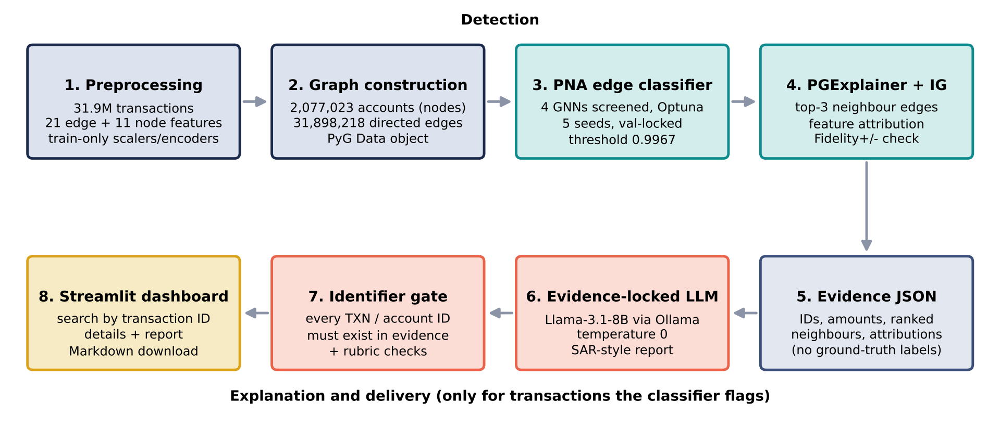
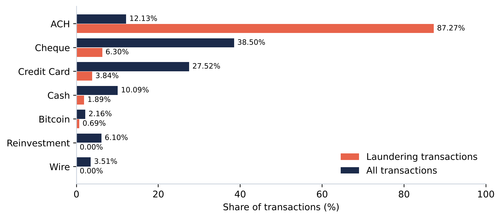
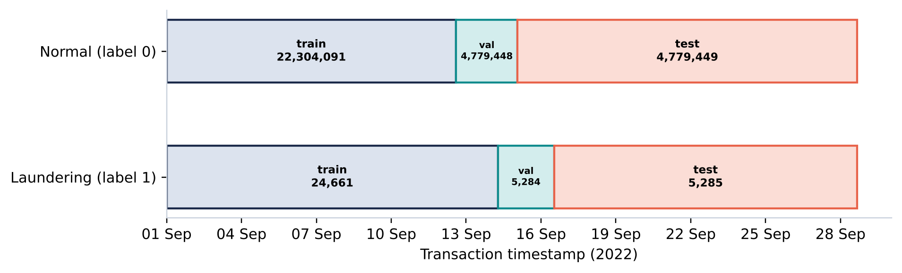
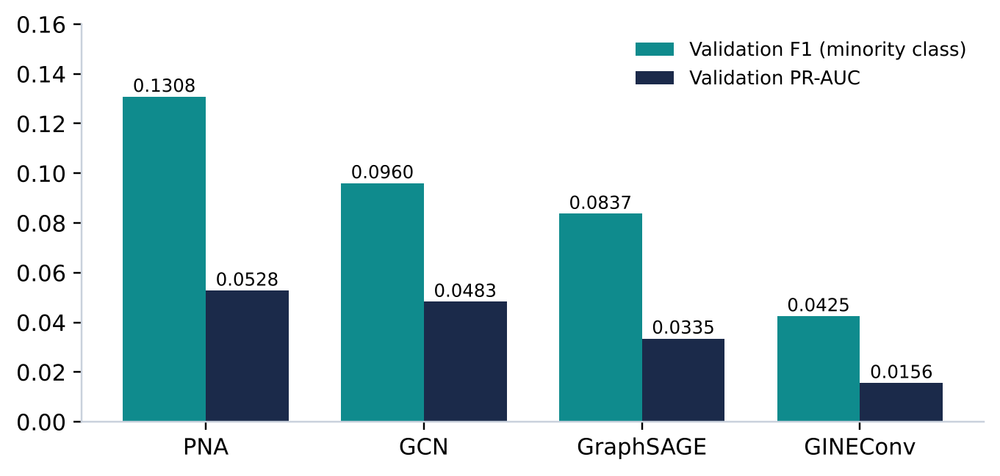
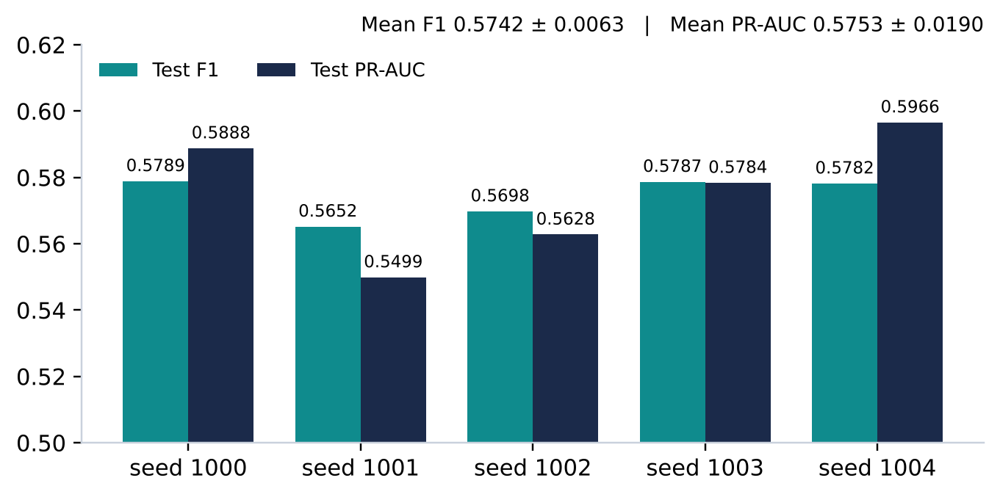
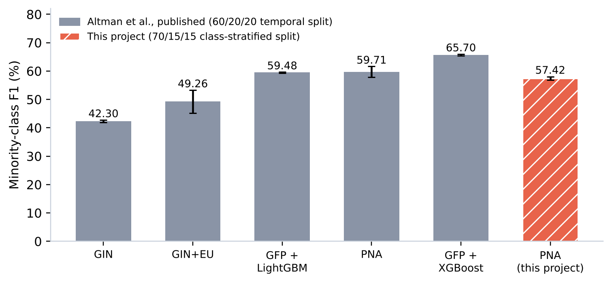
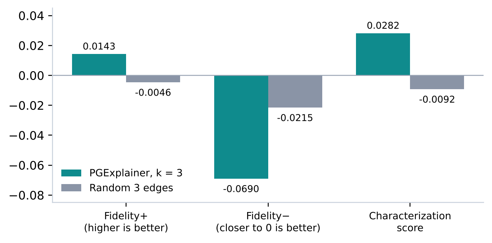
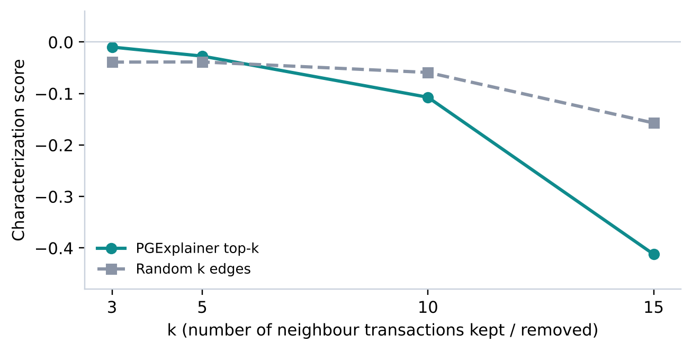
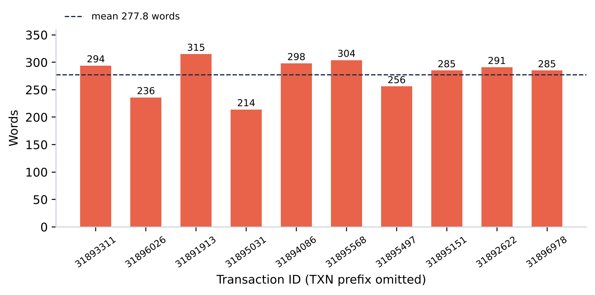

# AML-GNN-LLM-Explainer

**An LLM-Based Fraud Investigation Assistant for Anti-Money Laundering (AML) Detection**

A graph neural network flags suspicious transactions, an explainer shows which neighbouring transactions drove each decision, and a local open-source LLM turns that evidence into a SAR-style investigation report that an analyst can read in a dashboard.

> Master's Project (CISC 898), School of Computing, Queen's University, Group 16-AH.
> Industry partner: Capgemini Egypt. Supervisor: Dr. Anwar Hossain.


-000000)


---

## Overview

Rule-based AML systems produce large numbers of alerts with little explanation, so analysts spend most of their time reconstructing why a transaction was flagged. This project tackles detection and explanation together:

1. **Detect.** A PNA edge classifier scores every transaction in a graph of 2,077,023 accounts and 31,898,218 transactions.
2. **Explain.** A custom PGExplainer ranks the neighbouring transactions behind each flag, and Integrated Gradients ranks the transaction's own features.
3. **Report.** An evidence-locked LLM (Llama-3.1-8B, run locally through Ollama at temperature 0) writes a SAR-style report from that evidence only. An identifier gate rejects any report that cites a transaction or account ID that is not in the evidence.
4. **Serve.** A Streamlit dashboard lets an analyst search by transaction ID, see the transaction details, read the report and download it as Markdown.

No proprietary API is used anywhere in the pipeline. Every model runs on the team's own GPU server.

## Architecture



The upper row (detection) runs on every transaction. The lower row (explanation and delivery) runs only for transactions the classifier flags.

---

## Results

All numbers come from the notebook outputs and run logs.

### Dataset: IBM AML HI-Medium

| Item | Value |
|---|---|
| Transactions (after removing 20 duplicates) | 31,898,218 |
| Accounts (graph nodes, keyed by `Bank_Account`) | 2,077,023 |
| Laundering transactions | 35,230 (0.1104%, about 1 in 905) |
| Features | 21 edge features + 11 node features |
| Split (class-stratified temporal 70/15/15) | Train 22,328,752 · Val 4,784,732 · Test 4,784,734 |

Laundering is concentrated in one payment format: 87.27% of laundering transactions use ACH, against 12.13% of all transactions.



Each class is split in time order on its own, so train, validation and test all carry the same laundering rate.



### Detection: PNA edge classifier

Four GNNs were screened on validation (seed 42, 5 epochs):

| Model | Val F1 | Val PR-AUC |
|---|---|---|
| **PNA** | **0.1308** | **0.0528** |
| GCN | 0.0960 | 0.0483 |
| GraphSAGE | 0.0837 | 0.0335 |
| GINEConv | 0.0425 | 0.0156 |



PNA was then tuned with 30 Optuna trials (best val F1 0.2649) and evaluated once on the test set over 5 seeds, using a decision threshold locked on validation:

| Metric (test, 5 seeds) | Value |
|---|---|
| Minority-class F1 | **0.5742 ± 0.0063** |
| PR-AUC | **0.5753 ± 0.0190** |



For context, the published HI-Medium results from the dataset authors (Altman et al.) are shown below. They use a different split (60/20/20 temporal), so the comparison is indicative only.



### Explanation: PGExplainer (test set, 3,000 flagged transactions, k = 3)

| Metric | PGExplainer | Random 3 edges |
|---|---|---|
| Fidelity+ (higher is better) | 0.0143 | −0.0046 |
| Fidelity− (closer to 0 is better) | −0.0690 | −0.0215 |
| Characterization score | 0.0282 | −0.0092 |



The number of neighbour transactions kept or removed (k) was swept to see how the characterization score changes for PGExplainer compared with random edges.



### Reports: evidence-locked LLM (Llama-3.1-8B, temperature 0)

| Check | Result |
|---|---|
| Reports generated | 10 |
| Identifier gate passed | 10 / 10 |
| Valid reports | 10 / 10 |
| Mean length | 277.8 words |
| Ground truth of the explained transactions | 10 / 10 true laundering |



---

## Repository Structure

```text
AML-GNN-LLM-Explainer/
├── data/
│   ├── raw/                  # HI-Medium_Trans.csv (+ HI-Medium_Patterns.txt), not tracked
│   └── processed/            # generated artifacts, not tracked
├── docs/
│   ├── results/              # figures and plots used in this README
│   └── feature_dictionary.md # every edge and node feature, and why it was kept
├── src/
│   ├── preprocessing/
│   │   └── preprocessing_and_feature_engineering.py
│   ├── graph/
│   │   └── aml_graph_construction.py
│   ├── gnn/
│   │   └── train_baseline_comparison.py
│   ├── explainer/
│   │   └── pgexplainer.py
│   ├── llm/
│   │   ├── llm_layer_evaluation.py
│   │   └── llm_report_generation.py
│   └── dashboard/
│       ├── app.py
│       ├── data_loader.py
│       └── components.py
├── requirements.txt
├── CONTRIBUTING.md
└── README.md
```

Each script is the exact code of its original Jupyter notebook. Markdown cells are kept as comments, and `# %%` markers let VS Code, Spyder or Jupytext run them cell by cell.

| Script | What it does |
|---|---|
| `preprocessing_and_feature_engineering.py` | Load and clean the data, engineer features, split, fit scalers and encoders on train only, save artifacts and the lookup table |
| `aml_graph_construction.py` | Validate the artifacts, analyse connectivity, build and save the PyG graph |
| `train_baseline_comparison.py` | Screen four GNNs, run the Optuna search, run the 5-seed final evaluation, save the model |
| `pgexplainer.py` | Custom PGExplainer, Integrated Gradients, fidelity evaluation, `explain_transaction()` |
| `llm_layer_evaluation.py` | Evidence-locked prompt, metrics, LLM model-selection framework, serving wrapper |
| `llm_report_generation.py` | Generate and score SAR-style reports with Llama-3.1-8B |
| `app.py`, `data_loader.py`, `components.py` | Streamlit dashboard |

---

## Getting Started

### Requirements

- Python 3.12
- PyTorch and PyTorch Geometric, with a neighbour-sampling backend (`pyg-lib` or `torch-sparse`)
- pandas, NumPy, scikit-learn, NetworkX, matplotlib, Optuna, kagglehub, requests, openai, Streamlit
- An NVIDIA GPU for training and explanation (the project used a 15.7 GB A16), and enough RAM to hold the 31.9-million-edge graph
- [Ollama](https://ollama.com) for the LLM stages
- A Kaggle account and API token, with the dataset terms accepted once on the Kaggle website

### Installation

```bash
git clone https://github.com/Salmaabdelfattah73/AML-GNN-LLM-Explainer.git
cd AML-GNN-LLM-Explainer
python -m venv .venv
source .venv/bin/activate
pip install -r requirements.txt
ollama pull llama3.1:8b
```

### Data

The dataset is the [IBM Transactions for Anti-Money Laundering](https://www.kaggle.com/datasets/ealtman2019/ibm-transactions-for-anti-money-laundering-aml) dataset, HI-Medium variant. With `USE_KAGGLE = True`, the preprocessing script downloads it automatically with `kagglehub`. Otherwise, place `HI-Medium_Trans.csv` in `data/raw/` and set `RAW_DATA_PATH`.

### Configure Paths

Each script sets its data folder at the top: `OUTPUT_DIR`, `DATA_DIR` or `CANDIDATE_DATA_DIRS`. The committed values point to the team server (`/home/jovyan/AML_Project/...`). Change them to your own folder, for example `data/processed/`, before running.

### Run the Pipeline

Run the stages in order. Each stage reads the files that the previous one wrote.

```bash
# 1. Clean, engineer features, split, save arrays + lookup table
python src/preprocessing/preprocessing_and_feature_engineering.py

# 2. Build the PyG graph -> graph_data.pt
python src/graph/aml_graph_construction.py

# 3. Screen GNNs, tune PNA with Optuna, 5-seed test run -> best_model_pna.pt
#    (long job: run detached; the Optuna study resumes if interrupted)
nohup python -u src/gnn/train_baseline_comparison.py > train.log 2>&1 &

# 4. Train and evaluate PGExplainer -> pgexplainer_state.pt, predicted_positive_edges.pt
python src/explainer/pgexplainer.py

# 5. (Optional) Compare candidate LLMs: set RUN_KIND = "real" and keep Ollama running
python src/llm/llm_layer_evaluation.py

# 6. Generate the investigation reports -> llm_reports/
ollama serve &
python src/llm/llm_report_generation.py
```

### Run the Dashboard

```bash
cd src/dashboard
streamlit run app.py
```

Open http://localhost:8501, choose a transaction ID, read the LLM investigation summary and use **Download Report (.md)** to save it. The dashboard needs `transactions_lookup.csv` and the `llm_reports/` folder in one of the paths listed in `CANDIDATE_DATA_DIRS` inside `data_loader.py`.

### Main Artifacts

| Stage | Files written |
|---|---|
| Preprocessing | `edge_index.npy`, `edge_attr.npy`, `node_attr.npy`, `labels.npy`, `transaction_ids.npy`, `split_masks.npz`, scalers, encoders, `metadata.json`, `transactions_lookup.csv` |
| Graph | `graph_data.pt` |
| Training | `best_model_pna.pt`, `best_hyperparams_pna.json`, `baseline_comparison_summary.json`, `pna_optuna_study.db` |
| Explainer | `pgexplainer_state.pt`, `pgexplainer_config.json`, `predicted_positive_edges.pt` |
| LLM | `llm_reports/summary.json`, `llm_reports/all_reports.json` |

These files are several GB in total and are not tracked in Git. Running the scripts regenerates them.

---

## Key Design Decisions

- **Account node = `Bank_Account`.** Twelve account numbers appear under more than one bank, so the account number alone is not a unique key.
- **Class-stratified temporal split.** Each class is split 70/15/15 in time order. A plain time split gave the test set about ten times the laundering rate of the training set.
- **Train-only fitting.** Every scaler, encoder, degree histogram and hyperparameter is fitted on training or validation data. The test set is used once, to report the final numbers.
- **Validation-locked threshold.** Laundering is about 1 in 905 transactions, so a 0.5 threshold is meaningless. The threshold is chosen on validation (about 0.9967 for the saved model) and then fixed.
- **Evidence locking.** The LLM sees only the evidence object: IDs, amounts, ranked neighbours and attributions. It never sees the ground-truth label or the laundering pattern type, and its output passes an identifier gate.

See [docs/feature_dictionary.md](./docs/feature_dictionary.md) for the full list of edge and node features and why each one was kept or excluded.

## Limitations

- The class-stratified split differs from the published 60/20/20 temporal split, so the benchmark comparison is indicative only.
- Validation and test performance differ widely. Many test detections fall in the sparse end-of-September tail of the data, which may inflate the test F1.
- PGExplainer beats random edges on Fidelity+ and the characterization score at k = 3, but its Fidelity− (−0.0690) is further from zero than random (−0.0215), and at k = 10 and 15 its characterization score falls below the random baseline (see the k sweep above). The faithfulness of the explanations is therefore only partly supported.
- A known augmentation defect gives a wrong `is_reverse` flag to 10.47% of edge rows in subgraphs that contain a genuine self-transaction.
- The LLM selection framework has only been run in dry-run mode with an offline stub. A real comparison of the candidate models has not been run yet.
- The planned FastAPI backend was not delivered. The dashboard reads stored outputs, and explanations are not generated on demand.

---

## Team

| Name | Role | GitHub |
|---|---|---|
| Bassam Osman | Team Leader, GNN model and PGExplainer | [@bssam99](https://github.com/bssam99) |
| Salma Abdelfattah | Data preprocessing, feature engineering and graph construction | [@Salmaabdelfattah73](https://github.com/Salmaabdelfattah73) |
| Khaled Ashoush | LLM layer and evaluation | [@khaledashoush](https://github.com/khaledashoush) |
| Ahmed Nafea | Dashboard | [@a7mednafea](https://github.com/a7mednafea) |

**Supervisor:** Dr. Anwar Hossain
**Industry partner:** Capgemini Egypt (mentor: Norhan, Senior Data Engineer)

See [CONTRIBUTING.md](./CONTRIBUTING.md) for the branch and pull-request workflow.

## References

1. E. Altman et al., "Realistic synthetic financial transactions for anti-money laundering models," NeurIPS 2023 Datasets and Benchmarks Track, arXiv:2306.16424.
2. G. Corso et al., "Principal neighbourhood aggregation for graph nets," NeurIPS 2020.
3. D. Luo et al., "Parameterized explainer for graph neural network," NeurIPS 2020.
4. M. Sundararajan, A. Taly and Q. Yan, "Axiomatic attribution for deep networks," ICML 2017.
5. A. Grattafiori et al., "The Llama 3 herd of models," arXiv:2407.21783, 2024.
